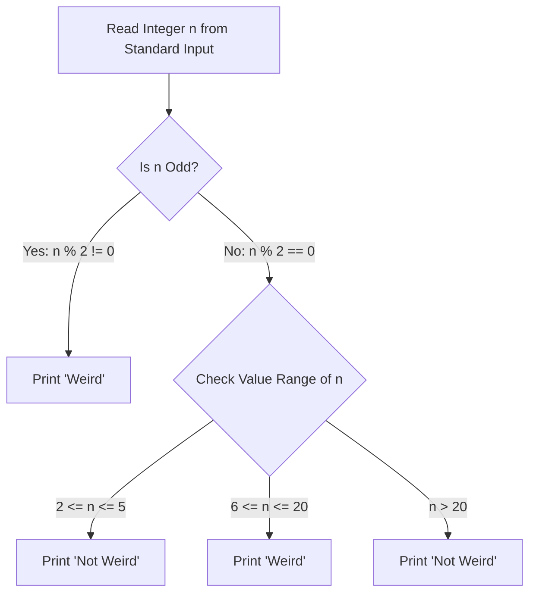

<div align="center">


[](https://www.python.org/)
[](https://www.hackerrank.com/)
[](#)
[](#)

</div>

---

## 📌 Executive Summary / Overview

The **Python Problem Solving Suite** (`Jeshwanthika7`) is a dedicated competitive programming repository containing verified solutions to core algorithmic challenges from platforms such as HackerRank, LeetCode, and CodeChef.

Beginning with conditional flow control (`001 Python if-else.py`), the repository captures solutions that enforce boundary handling, efficient time complexities, and clean syntax according to standardized competitive programming constraints.

---

## 📖 Interactive Table of Contents

- [Executive Summary / Overview](#-executive-summary--overview)
- [Key Features & Capabilities](#-key-features--capabilities)
- [Algorithmic Decision Tree & Logic](#-algorithmic-decision-tree--logic)
- [Tech Stack Breakdown](#-tech-stack-breakdown)
- [Problem Specification & Rules](#-problem-specification--rules)
- [Reproducible Quickstart & Setup](#-reproducible-quickstart--setup)
- [Project Directory Layout](#-project-directory-layout)
- [Author & Contributions](#-author--contributions)

---

## ✨ Key Features & Capabilities

- **Strict Boundary Evaluation**: Implements precise range checks conforming to competitive problem specifications ($n \in [1, 100]$).
- **Fast Standard I/O**: Parses integer inputs using stripped stream buffers (`input().strip()`).
- **Optimal Time & Space Efficiency**: Achieves $O(1)$ constant time complexity and $O(1)$ space complexity.
- **Idiomatic Guard Clauses**: Uses clean `if __name__ == '__main__':` execution guards for modular imports.

---

## 🏗️ Algorithmic Decision Tree & Logic



---

## 🛠️ Tech Stack Breakdown

| Category | Technologies & Tools |
| :--- | :--- |
| **Language** | Python 3.9+ |
| **Domain** | Competitive Programming, Algorithmic Logic |
| **Platforms** | HackerRank, LeetCode, CodeChef |
| **Complexity Profile**| $O(1)$ Time, $O(1)$ Auxiliary Space |

---

## 📋 Problem Specification & Rules

Given an integer $n$, perform the following conditional actions:
- If $n$ is **odd**, print `Weird`.
- If $n$ is **even** and in the inclusive range of **2 to 5**, print `Not Weird`.
- If $n$ is **even** and in the inclusive range of **6 to 20**, print `Weird`.
- If $n$ is **even** and **greater than 20**, print `Not Weird`.

---

## 🚀 Reproducible Quickstart & Setup

### Prerequisites
- Python 3.x installed

### Step 1: Clone the Repository
```bash
git clone https://github.com/Jeshwanthika07/Jeshwanthika7.git
cd Jeshwanthika7
```

### Step 2: Run the Script
```bash
python "001 Python if-else.py"
```
Enter an integer (e.g. `3` or `24`) to observe the evaluated classification output.

---

## 📂 Project Directory Layout

```text
Jeshwanthika7/
│
├── 001 Python if-else.py      # Solved conditional action problem script
└── README.md                  # Comprehensive problem solving documentation
```

---

## 👩‍💻 Author & Contributions

Authored by **[Jeshwanthika Pothamchetty](https://github.com/Jeshwanthika07)**  
*Alliance University | Department of Computer Applications*

<div align="center">


</div>
